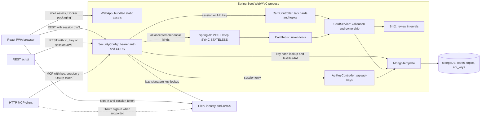

# Architecture

[Documentation home](../README.md) · [Canonical Mermaid source](architecture.mmd)

Brainrot has one Spring Boot process with REST and HTTP MCP entry points, a React browser app and a MongoDB database. Clerk supplies identity/token signing keys; the application stores cards/topics/API keys, not Clerk account credentials. The Docker build embeds the frontend in the jar. In development, Vite on 8089 serves the frontend separately from the backend on 8088.

## Implemented component and data flow

The following block is identical to `docs/architecture.mmd`. Solid edges describe requests or in-process calls; the dotted edge is an OAuth-capable client's optional sign-in path, not a requirement for API-key clients. Arrows show request direction, with responses returning over the same path. Static asset delivery is public; data calls pass through security.

## Boundaries and source evidence

| Component / claim | Executable source |
| --- | --- |
| Process entry, Java/Spring dependencies | [FlashcardsApplication.java](../src/main/java/app/flashcards/FlashcardsApplication.java), [pom.xml](../pom.xml) |
| Browser routing, Clerk sign-in and React Query | [App.tsx](../frontend/src/App.tsx), [main.tsx](../frontend/src/main.tsx), [api.ts](../frontend/src/api.ts) |
| Read-only Freestyle session and route-persistent review writes | [Freestyle.tsx](../frontend/src/screens/Freestyle.tsx), [useFreestyleSession.ts](../frontend/src/hooks/useFreestyleSession.ts), [ReviewWrites.tsx](../frontend/src/components/ReviewWrites.tsx) |
| Embedded static hosting, deep-link forwards and cache headers | [WebApp.java](../src/main/java/app/flashcards/WebApp.java), [Dockerfile](../Dockerfile) |
| Stateless bearer authentication, JWT/JWKS, API-key filter and OAuth discovery | [SecurityConfig.java](../src/main/java/app/flashcards/SecurityConfig.java) |
| REST / MCP adapters sharing user-scoped logic | [CardController.java](../src/main/java/app/flashcards/CardController.java), [CardTools.java](../src/main/java/app/flashcards/CardTools.java), [CardService.java](../src/main/java/app/flashcards/CardService.java) |
| Session-only key management and hash persistence | [ApiKeyController.java](../src/main/java/app/flashcards/ApiKeyController.java), [ApiKey.java](../src/main/java/app/flashcards/ApiKey.java) |
| Scheduler called synchronously during review, not a background job | [Sm2.java](../src/main/java/app/flashcards/Sm2.java), [CardService.java](../src/main/java/app/flashcards/CardService.java) |
| MongoDB collections/indexes | [Card.java](../src/main/java/app/flashcards/Card.java), [Topic.java](../src/main/java/app/flashcards/Topic.java), [ApiKey.java](../src/main/java/app/flashcards/ApiKey.java) |
| SYNC/STATELESS MCP, auto-index creation and defaults | [application.yml](../src/main/resources/application.yml) |
| PWA app-shell precache; no API offline synchronization | [vite.config.ts](../frontend/vite.config.ts), [api.ts](../frontend/src/api.ts) |

Security extracts the user before REST controllers/MCP tools delegate to CardService. API keys are looked up through MongoTemplate in the filter; JWT verification uses Clerk JWKS fetched lazily. OAuth access tokens are MCP-only; session JWTs and API keys can use card/topic REST as well. Only session JWTs can manage API keys. The [API page](api.md) details token validation and discovery.

MongoTemplate is used directly: there is no repository-interface layer, SQL database, message broker, job worker, scheduler service or backend LLM provider call in the implemented path. The MCP client may be an AI agent, but the backend exposes deterministic tools rather than generating flashcards through a model itself.

Inside the existing browser node, `/` is scheduled review and `/freestyle` is ungraded practice. Freestyle reads paginated cards/topics through the same protected REST boundary and initiates no card/review writes; it adds no backend service, schema or MCP tool. The authenticated frontend mounts its scheduled-review write coordinator above routes, so an already submitted review can finish while another screen is open. This coordinator is in-memory browser state, not a durable queue or new server component. [Data semantics](data-model.md#frontend-state-and-network-limits) covers retry ambiguity and session lifetime. The high-level diagram remains unchanged because the implemented process and network boundaries are unchanged. `WebApp` now forwards `/freestyle` alongside the existing client deep links to `/index.html`.

## Hosting and limitations

The [Dockerfile](../Dockerfile) builds frontend assets, bundles them into the jar and runs one JRE process. [compose.yaml](../compose.yaml) defines only a development MongoDB service with a persistent volume. No deployment platform, reverse-proxy topology, TLS termination, replica configuration or production backup guarantee is established by these files. Those must not be inferred from the diagram.

Static hashed assets receive long immutable caching; the index/service-worker/manifest paths are rechecked. The frontend caches a shell but needs network access for Clerk and API data. Browser query state and the play queue are in memory, not durable offline storage. See [data semantics](data-model.md) and [development/validation limits](development.md).

The baseline audit covered source `5bd432a569b429f086b7a94ffbdcd9821a90e3f4`; the incremental review through `8c2a9bf3ce5e2c609cafb8dbef920f5ef3026131` checked affected frontend/hosting paths and reran local tests/builds, including stubbed Chromium flows. Neither review connected to production, used existing databases or performed live OAuth sign-in. The incremental route test verifies MVC forwarding, not a packaged deployment or installed-PWA behavior.
